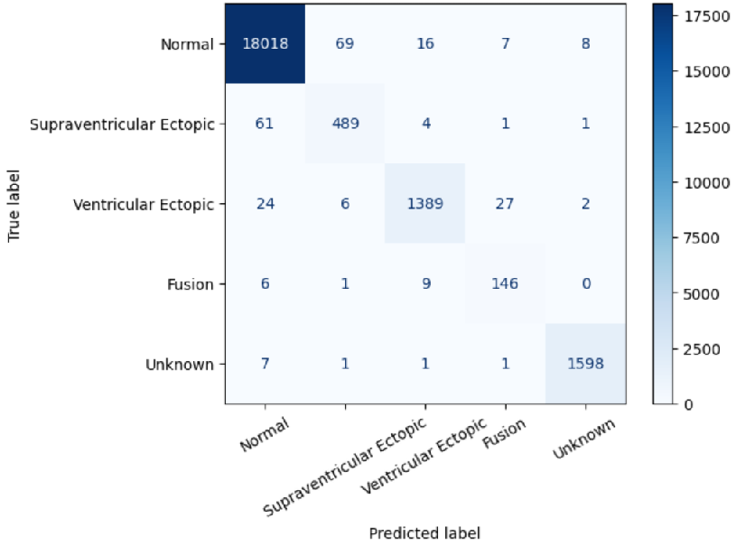
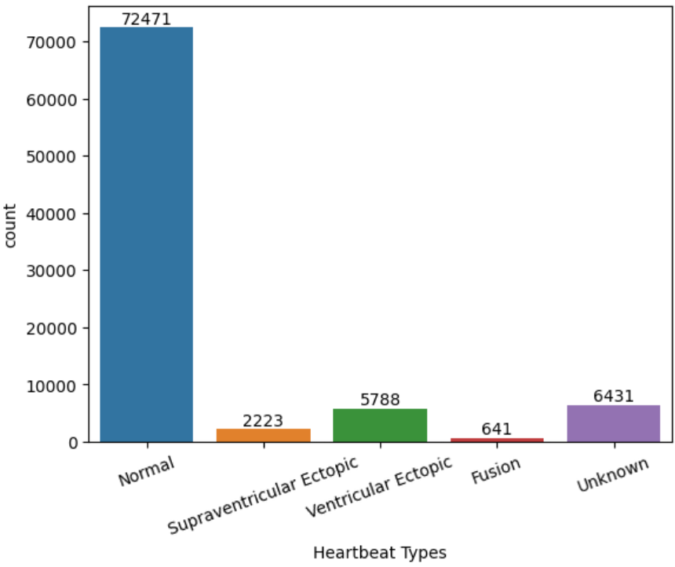

# 🫀 ECG Heartbeat Classification: CNN vs. Transformer


## 📖 Project Overview
Electrocardiogram (ECG) signals carry crucial information about the electrical activity of the heart, making automatic beat classification a vital task in modern healthcare and real-time monitoring systems. 

This project presents a complete end-to-end deep learning pipeline designed to classify 5 different types of ECG heartbeats (Normal, Supraventricular Ectopic, Ventricular Ectopic, Fusion, Unknown) using the **MIT-BIH Arrhythmia dataset** (187 time-steps per sample). 

The primary challenge was the severe class imbalance in the biomedical data (over 82% of samples were "Normal"). The project explores two powerful architectures—a **1D CNN** and a **Transformer**—and demonstrates how domain-specific data augmentation can drastically improve minority class detection.

## ⚙️ Methodology & Pipeline
1. **Data Augmentation:** Since deep learning on imbalanced biomedical data is challenging, I engineered custom, physiologically safe augmentation techniques for 1D signals (Gaussian noise injection, time-shifting, and time-warping) to balance the minority classes.
2. **CNN Architecture:** Built a 4-block 1D Convolutional Neural Network using dilated convolutions, Batch Normalization, and `SpatialDropout1D` to capture local waveform patterns and prevent overfitting.
3. **Transformer Architecture:** Implemented a custom Transformer model from scratch using Multi-Head Self-Attention and custom Positional Encoding to capture long-range temporal dependencies.
4. **Benchmarking:** Trained a baseline CNN on the raw, imbalanced data to establish a reference point, then compared it against the augmented Transformer and augmented CNN.

## 🏆 Results
The data augmentation strategy drastically improved minority class detection. Interestingly, the 1D CNN significantly outperformed the Transformer on this specific task. 

| Model | Data Used | Accuracy | Macro Recall |
| :--- | :--- | :--- | :--- |
| Baseline CNN | Imbalanced | 82.7% | 0.20 |
| Transformer | Augmented | 95.6% | 0.84 |
| **1D CNN (Winner)** | **Augmented** | **98.8%** | **0.94** |

## 💡 Key Insights
* **CNN vs. Transformer for ECG:** While Transformers are excellent for long-sequence NLP tasks, this project demonstrated that for short, localized biomedical signals (like a 187-step ECG waveform), Convolutional Neural Networks are significantly more parameter-efficient and accurate. CNNs are inherently better at capturing the local morphological features (peaks and slopes) of heartbeats.
* **The Power of Augmentation:** Targeted domain-specific augmentation (rather than simply increasing model complexity) was the key to achieving high accuracy. It prevented the model from ignoring the minority classes.
* **Macro Metrics are Critical:** In medical classification, Accuracy is a misleading metric. Using **Macro Recall** revealed that the baseline model completely failed on minority classes (0.20), whereas the augmented models successfully detected critical heart conditions.

## 📊 Visualizations




## 📂 Repository Structure
```text
├── notebooks/
│   └── ecg-classification-cnn-vs-transformer.ipynb    # Main Jupyter Notebook
├── requirements.txt                                   # Python dependencies
└── README.md                                          # Project documentation
---
```
## 🚀 How to Run

1. Clone the repository:
   git clone https://github.com/AliPakzad/ECG-Heartbeat-Classification-with-Deep-Learning-CNN-vs-Transformers.git

2. Install the required packages:
   pip install -r requirements.txt

3. Open the Jupyter Notebook and run the cells:
   jupyter notebook notebooks/ecg-classification-cnn-vs-transformer.ipynb

## 🔗 Links
* **Kaggle Notebook:** [Insert your specific Kaggle Notebook Link Here]
* **LinkedIn:** https://www.linkedin.com/in/ali-pakzad-b145a3b4
* **GitHub Profile:** https://github.com/AliPakzad

---
**Author:** Ali Pakzad (Data Scientist & ML Engineer)
